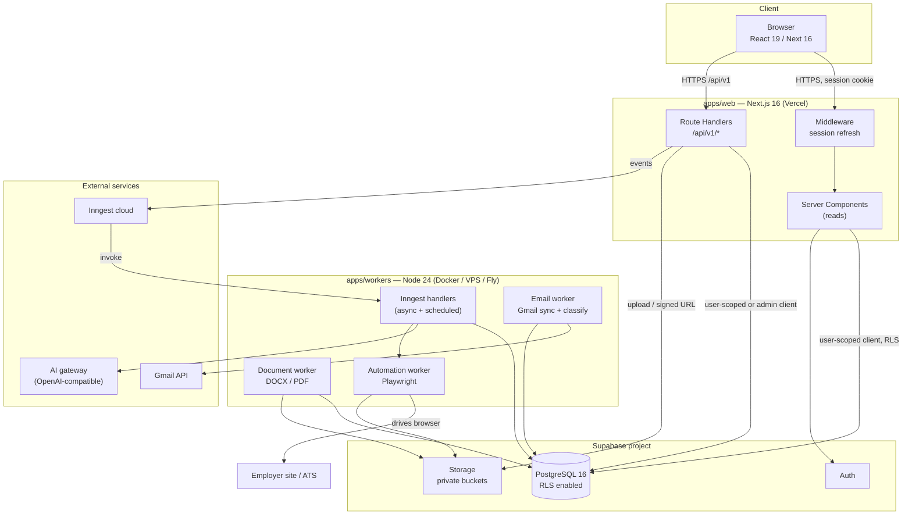
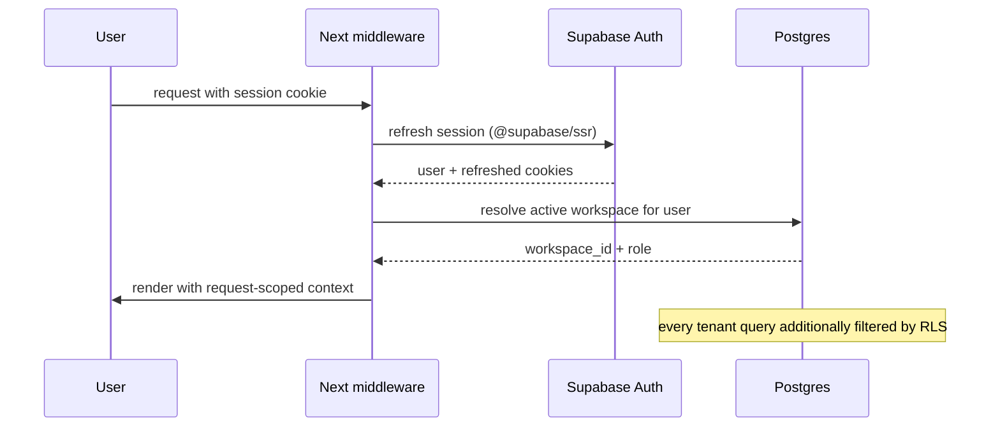

# CareerOS — Architecture Proposal

**Status:** Phase 0 proposal — awaiting owner approval
**Companion documents:** `DATABASE.md`, `SECURITY.md`, `AI_AGENTS.md`, `DEPENDENCIES.md`,
`ROADMAP.md`, `PHASE0_REVIEW.md`

---

## 1. Summary

CareerOS is one Next.js application plus one background worker process, deployed separately, over a
single Supabase PostgreSQL database.

- **Modular monolith** for the product surface: one deployable web app, internally partitioned by
  product module, not one service per module.
- **Workers** for anything slow, retryable, or requiring a persistent process: AI batch work,
  document rendering, email ingestion, browser automation.
- **PostgreSQL is the only source of truth.** Row Level Security is the authorization boundary, not
  application `if` statements.
- **AI is a replaceable dependency**, never embedded in business logic or UI.

This deliberately avoids microservices. For a personal-first product with a single owner operator, a
modular monolith plus workers is the smallest architecture that still satisfies every requirement in
the spec (async workflows, isolation, audit, multi-tenancy).

---

## 2. Runtime topology



**Why two deployables and not one:** Next.js route-handler execution limits (Vercel function
duration) cannot host multi-minute AI generation, PDF rendering at scale, or a persistent Playwright
browser. Separating them also means a runaway browser session cannot degrade the web app.

---

## 3. Module boundaries

The spec's ten product modules map to code boundaries as follows. Each module owns its own Zod
schemas, domain services, route handlers, and UI features. Cross-module access happens **only**
through the other module's exported service functions — never by reaching into its tables directly
from another module's UI.

| Module | Priority | Web feature folder | Domain services (`packages/core`) | Primary tables |
|---|---|---|---|---|
| 1. Master Career Profile | P0 | `features/career-profile` | `profile`, `achievements`, `positions` | `career_profiles`, `experiences`, `projects`, `skills`, `achievements`, `career_positions*`, `job_preferences` |
| 2. Resume Intelligence Studio | P0 | `features/resume-studio` | `documents`, `resume-parse` | `documents`, `document_versions`, `document_claims`, `document_templates` |
| 3. Job Discovery | P0 | `features/job-discovery` | `jobs`, `job-import` | `jobs`, `job_requirements` |
| 4. AI Job Matching | P0 | `features/job-matching` | `matching` | `match_assessments`, `ai_runs` |
| 5. Application Studio | P0 | `features/application-studio` | `generation` | `documents`, `document_versions`, `document_claims` |
| 6. Application Management | P0 | `features/applications` | `applications`, `approvals` | `applications`, `application_events`, `application_documents`, `application_answers`, `approvals` |
| 7. Application Automation | P1 | `features/automation` | `automation` (worker-side) | `automation_runs`, `submission_attempts` |
| 8. Gmail Integration | P1 | `features/integrations` | `integrations`, `email` | `integrations`, `integration_tokens`, `email_events` |
| 9. Career Analytics | P1 | `features/analytics` | `analytics` (SQL views/RPC) | read-only over the above |
| 10. Profile Optimization | P1 | `features/profile-optimization` | `generation` (reuses) | `documents`, `document_versions` |

Cross-cutting modules: `workspaces` (tenancy), `auth`, `audit`, `ai-runtime`, `document-engine`.

---

## 4. Layering rules

```
apps/web/src/app/**            UI + route handlers      (thin: parse, authorize, delegate)
apps/web/src/components/**     presentational           (no data fetching, no business rules)
apps/web/src/features/**       module UI + hooks        (calls /api/v1 only)
apps/workers/src/**            queue consumers          (thin: validate, delegate, record)
        │
        ▼
packages/core/**               business rules, use cases, invariants
        │
        ▼
packages/database/**           repositories, Supabase clients, generated DB types
packages/ai/**                 provider adapters, agents, prompt registry, output schemas
```

Hard rules, enforced by review and (from Phase 1) by an ESLint import-boundary rule:

1. **No business logic in `components/`.** Components render props. Any rule that decides something
   (score bands, status transitions, approval validity) lives in `packages/core`.
2. **`packages/core` must not import Next.js, React, or Supabase clients directly.** It receives a
   repository interface. This is what makes "no duplicated logic between frontend and backend" real
   rather than aspirational — the same function serves a route handler, a worker, and a test.
3. **Only `packages/database` may construct a database client.**
4. **Only server code may import the service-role client.** A lint rule and a runtime guard forbid it
   in any `"use client"` file.
5. **`packages/ai` never receives a database handle.** Agents get plain typed inputs and return
   validated typed outputs. This is the spec's "never give AI agents unrestricted database access",
   implemented structurally.

### Why a `packages/core` that the spec does not list

The spec's tree has `packages/{ai,database,shared-types,validation,document-engine}` and puts
business logic implicitly in `apps/web`. That conflicts with rules 8 and 9 of Part 1 ("keep business
logic separate from UI", "do not duplicate business logic"). Without a dedicated domain package,
workers and the web app would each reimplement matching, approval, and status rules. Adding
`packages/core` resolves the conflict with no new infrastructure.

---

## 5. Proposed repository structure

```text
careeros/
├─ apps/
│  ├─ web/                            # Next.js 16, App Router  (deployable #1)
│  │  ├─ src/
│  │  │  ├─ app/
│  │  │  │  ├─ (auth)/login|signup|callback/
│  │  │  │  ├─ (app)/
│  │  │  │  │  ├─ dashboard/
│  │  │  │  │  ├─ profile/
│  │  │  │  │  ├─ resume-studio/
│  │  │  │  │  ├─ jobs/
│  │  │  │  │  ├─ applications/
│  │  │  │  │  ├─ analytics/
│  │  │  │  │  └─ settings/{integrations,ai,account}/
│  │  │  │  └─ api/v1/**              # versioned REST surface
│  │  │  ├─ components/               # shadcn primitives + shared presentational
│  │  │  ├─ features/                 # one folder per module (see §3)
│  │  │  ├─ lib/                      # client helpers, fetcher, formatters
│  │  │  └─ middleware.ts
│  │  ├─ public/
│  │  └─ package.json
│  └─ workers/                        # Node 24 service  (deployable #2)
│     ├─ src/
│     │  ├─ index.ts                  # Inngest serve() + health endpoint
│     │  ├─ inngest/functions/        # job-discovery, doc-generation, email, automation
│     │  ├─ automation/               # Playwright runner + per-ATS adapters
│     │  └─ lib/
│     └─ package.json
├─ packages/
│  ├─ core/                           # domain logic; framework-free
│  ├─ database/                       # clients + repositories + generated types
│  ├─ ai/                             # providers/ agents/ prompts/ schemas/
│  ├─ validation/                     # shared Zod schemas
│  ├─ shared-types/                   # enums + DTO types, zero runtime deps
│  ├─ document-engine/                # templates, DOCX, PDF, parsing
│  └─ config/                         # tsconfig / eslint / tailwind presets
├─ supabase/
│  ├─ migrations/                     # SQL migrations — single source of truth
│  ├─ seed.sql
│  └─ config.toml
├─ docs/
├─ tests/
│  ├─ integration/                    # DB + RLS + domain, against a real database
│  └─ e2e/                            # Playwright against the running app
├─ .env.example
├─ .gitignore
├─ pnpm-workspace.yaml
├─ turbo.json
├─ package.json
└─ README.md
```

### Deviations from the spec's tree, and why

| Spec | Proposal | Reason |
|---|---|---|
| `apps/workers/{email-processing,document-generation,browser-automation,job-discovery}` as four apps | **One** `apps/workers` with four `src/inngest/functions` groups | Inngest registers functions from one serve endpoint; four deployables would multiply infrastructure for no isolation benefit. Isolation that matters (browser) is a separate *process/container*, not a separate repo app |
| No `packages/core` | Added | Resolves the "no duplicated business logic" conflict (§4) |
| `packages/shared-types` | Kept, but **types only** | Zod schemas live in `packages/validation`; types derive from them |
| `apps/web/src/lib` only | Added `features/` (already implied by spec) and `components/ui` (shadcn) | Matches the spec's feature-folder intent |

The spec's instruction "do not create empty modules solely to match the folder tree" is honoured:
directories are created when their first real file lands, not up front as placeholders.

---

## 6. Data access strategy

**Decision: Supabase client + generated TypeScript types + SQL for analytical queries. No ORM in the
MVP.**

| Concern | Approach |
|---|---|
| Typed CRUD | `@supabase/supabase-js` with types generated by `supabase gen types typescript` |
| RLS enforcement | All user-scoped access uses a **user-scoped client** carrying the session cookie, so Postgres enforces tenancy |
| Trusted operations (workers, cross-tenant jobs) | Server-only **admin client** using the service-role key; every call site is explicit and reviewed |
| Complex reads (analytics, funnel, duplicate detection) | SQL **views** and `security invoker` functions, typed manually in `packages/database` |
| Migrations | Plain SQL in `supabase/migrations`, applied with the Supabase CLI |
| Domain invariants | Enforced by DB constraints and triggers where possible (dates, immutability, approval uniqueness), not only in app code |

Why not Drizzle/Prisma: the Supabase CLI already owns migrations, and mixing a second migration tool
with `supabase/migrations` is a known source of drift. An ORM would also need to bypass or duplicate
RLS semantics. A thin repository layer over generated types keeps exactly one migration owner.
Revisit only if type ergonomics on complex queries becomes painful (recorded as ADR-004, revisitable).

---

## 7. Authentication and workspace context



- Authentication: Supabase Auth. Method is an open decision (**D4**); recommendation is email +
  password with mandatory email confirmation for MVP, magic link as an alternative.
- On first sign-in, a database trigger creates `public.users`, a personal `workspaces` row, and an
  `owner` `workspace_members` row. No client-side bootstrap race.
- The active workspace is resolved server-side from membership; a client-supplied `workspace_id` is
  never trusted. RLS independently re-checks it.
- Two independent layers: the app filters by workspace, and Postgres rejects anything outside
  membership. A bug in one does not leak data through the other.

---

## 8. API surface

**Decision: `/api/v1` route handlers are the only mutation surface.**

- Reads for page rendering use Server Components calling `packages/core` directly (no self-fetch).
- All mutations and all client-side data loading go through versioned route handlers, so the same
  endpoints serve the UI, tests, and any future client.
- **Server Actions are not used for mutations.** Two parallel mutation surfaces is exactly the
  duplication the spec forbids; one contract is simpler to test and to authorize.
- Every handler: resolve session → resolve workspace → authorize → validate with Zod → call a core
  service → map the result → log an audit entry for state changes.

| Group | Routes |
|---|---|
| Profile | `GET/PATCH /api/v1/profile`, `/experiences`, `/projects`, `/skills`, `/achievements`, `/positions`, `/preferences` |
| Jobs | `POST /api/v1/jobs/import` (text \| url \| file \| alert), `GET /api/v1/jobs`, `POST /api/v1/jobs/:id/match`, `POST /api/v1/jobs/:id/duplicate-check` |
| Documents | `GET/POST /api/v1/documents`, `/documents/:id/versions`, `POST /documents/generate`, `POST /documents/:id/export` |
| Applications | `GET/POST /api/v1/applications`, `PATCH /:id/status`, `POST /:id/approve`, `POST /:id/submit`, `GET /:id/events` |
| Integrations | `GET /api/v1/integrations`, `POST /integrations/gmail/start`, `GET /integrations/gmail/callback`, `DELETE /:id` |
| Automation | `POST /api/v1/automation/prepare`, `GET /automation/:runId/preview`, `POST /automation/:runId/execute` |
| AI | `GET /api/v1/ai/models`, `GET /ai/usage` |
| Analytics | `GET /api/v1/analytics/funnel`, `/sources`, `/resumes`, `/rejections` |

Conventions: JSON bodies; `application/problem+json` errors; `Idempotency-Key` required on submit;
cursor pagination; every response includes the workspace it was scoped to; ISO-8601 timestamps.

---

## 9. Asynchronous workflows

Inngest is the queue, retry, and scheduler. Each function is idempotent and writes an `ai_runs` or
`automation_runs` row.

| Event | Function | Notes |
|---|---|---|
| `job.imported` | `extract-job-requirements` | AI structured extraction → `job_requirements`; idempotent on `input_hash` |
| `job.extracted` | `compute-job-match` | Deterministic weighted scoring + AI qualitative layer; writes immutable `match_assessments` |
| `job.match.completed` | `refresh-discovery-ranking` | Recompute discovery ordering |
| `resume.generation.requested` | `generate-document` | Renders version, writes `document_claims` traceability rows |
| `resume.generation.completed` | `render-document-artifacts` | DOCX + PDF into Storage; sets hashes |
| `application.approval.granted` | `prepare-submission` | Verifies approval, builds payload, requires fresh approval if hash changes |
| `application.submission.requested` | `execute-submission` | Playwright worker; idempotency key; never bypasses CAPTCHA |
| `application.submission.completed` | `record-submission` | Appends event, stores confirmation evidence, updates status |
| `email.received` | `classify-email` | Gmail push/poll → classify → link with confidence → needs-review queue |
| `application.status.updated` | `schedule-followups` | Creates `reminders` |
| cron (hourly) | `sync-gmail`, `expire-approvals`, `flag-stale-applications` | Scheduled maintenance |

Failure policy: retries with backoff; after N attempts the run is marked failed and surfaced in the
UI. Nothing is silently dropped. Approval expiry is enforced by a scheduled sweep **and** by a check
at consumption time.

Why Inngest rather than a hand-rolled queue: the spec names it, it provides retries, idempotency,
scheduling, and step replay without new infrastructure. Fallback documented (ADR-011): `pg-boss`,
which runs entirely inside the existing Postgres and removes the external dependency if Inngest
proves unavailable.

---

## 10. AI architecture (summary — details in `AI_AGENTS.md`)

```
input → context assembly (typed facts only) → prompt (versioned) → provider adapter
      → structured output → Zod validation → business-rule validation
      → user review where required → persistence + ai_runs record
```

- **One default adapter: OpenAI-compatible**, configured by `AI_BASE_URL` + `AI_API_KEY`, with a
  model registry that maps logical roles (`bulk_extraction`, `reasoning`, `writing`, …) to concrete
  model IDs. This matches the verified environment and keeps the product portable.
- Native adapters for OpenAI, Anthropic, and DeepSeek exist behind the same interface and are
  selected by configuration, not by code changes.
- Agents are thin: they assemble input, call the adapter, and validate output. They cannot query the
  database, cannot write to it, and cannot promote an achievement's verification status.

---

## 11. Document engine

- **Canonical form:** structured JSON (resume AST), not HTML or a raw DOCX blob.
- **Rendering:** DOCX from that AST via `docx`; PDF via the same template data through a
  PDF renderer, not by converting DOCX.
- **Immutability:** every render produces a new `document_versions` row with a content hash. Once a
  version is attached to a submitted application, the DB forbids mutation of its content.
- **Traceability:** every generated bullet is recorded in `document_claims` pointing at the
  `experiences` / `projects` / `achievements` row it came from. A claim with no fact reference fails
  validation, which is how "no fabricated information" becomes testable.
- **ATS readability:** single column, no text boxes, no tables for layout, embedded standard fonts,
  headings as real headings, no images in the text layer.

---

## 12. Browser automation (P1)

- Separate Node process, Chromium via Playwright, one browser context per run.
- Storage state encrypted at rest; never exposed to the browser client.
- Flow is prepare → preview → **explicit approval** → execute, with the approved payload hash bound
  to the run. Any change after approval voids it.
- Hard stops: CAPTCHA, unknown legal/sensitive declaration, unsupported site, login expired, page
  changed shape. On a hard stop the run aborts and hands back to manual guidance.
- Local-only in the MVP (decision **D6**), because Vercel cannot host a persistent browser.

---

## 13. Architecture decision records

| ADR | Decision | Status |
|---|---|---|
| ADR-001 | Modular monolith + one separate worker deployable (not microservices) | Proposed |
| ADR-002 | `/api/v1` route handlers are the only mutation surface; no Server Actions for writes | Proposed |
| ADR-003 | Supabase Postgres/Auth/Storage; RLS is the authorization boundary | Proposed |
| ADR-004 | Supabase-generated types + SQL views; no ORM in MVP; Drizzle deferred | Proposed |
| ADR-005 | SQL-first migrations via Supabase CLI; single migration owner | Proposed |
| ADR-006 | One OpenAI-compatible AI adapter + data-driven model registry; native adapters optional | Proposed |
| ADR-007 | Zod validation at every boundary, including AI output and worker payloads | Proposed |
| ADR-008 | Canonical resume AST; independent DOCX and PDF renderers | Proposed |
| ADR-009 | Approval is a signed, expiring, single-use artifact binding payload hash + document versions | Proposed |
| ADR-010 | Playwright runs in an isolated worker; local-only until Phase 5 exit | Proposed |
| ADR-011 | Inngest for async; `pg-boss` as documented fallback | Proposed |
| ADR-012 | pnpm + Turborepo monorepo; domain logic in `packages/core` | Proposed |
| ADR-013 | Private Storage buckets partitioned by `workspace_id/...` | Proposed |
| ADR-014 | Immutability (assessments, events, submitted documents) enforced by DB triggers, not convention | Proposed |
| ADR-015 | No job-board scraping; manual, URL, file, and alert import only for MVP | Proposed |

---

## 14. Deployment model

| Component | Target | Notes |
|---|---|---|
| `apps/web` | Vercel | Node 24 runtime; region close to the Supabase project |
| `apps/workers` | Docker container on a VPS / Fly / Railway | Needs persistent disk for browser artifacts; not serverless |
| Database + Auth + Storage | Supabase (cloud project) | RLS, private buckets, backups |
| Inngest | Inngest cloud (or self-hosted) | Dev server locally |
| Secrets | Vercel env + worker env | Service-role key **never** in the browser bundle |

Environments: `local` → `preview` → `production`. Migrations are applied to preview before
production; no manual dashboard edits to production schema.

---

## 15. Known architectural risks

| ID | Risk | Impact | Mitigation |
|---|---|---|---|
| AR-1 | AI gateway currently returns 402 | Blocks Phases 3–5 AI work | Resolve billing or supply a first-party key (D2); build adapter + fixtures so logic is testable without live calls |
| AR-2 | No Supabase project/credentials | Blocks Phase 1 | Owner creates project or approves local stack (D1) |
| AR-3 | Gateway is a reseller; PII leaves the trust boundary | Confidentiality/compliance | Treat as untrusted, prefer first-party accounts, configurable base URL (D2, SECURITY §7) |
| AR-4 | Gmail restricted scopes require Google verification | Blocks Phase 5 in production | Test users during development; plan verification early (D7) |
| AR-5 | Windows dev vs Linux deploy drift | "Works on my machine" | Cross-platform scripts, Docker for workers, CI on Linux |
| AR-6 | Multi-tenant design cost for a single-user MVP | Slower Phase 1 | Keep it — retrofitting `workspace_id` + RLS later is materially riskier than building it now |
| AR-7 | Next 16 + React 19 + Tailwind 4 + shadcn churn | Build instability | Pin exact versions; verify shadcn compatibility in a Phase 1 spike before building UI |
| AR-8 | No ORM means more hand-written SQL for analytics | Dev velocity | Accept for now; views/RPC are simpler to reason about for funnel maths |
| AR-9 | Playwright against third-party sites is brittle | Automation failure | Adapter per ATS, hard stops, manual fallback, no blind retries |
