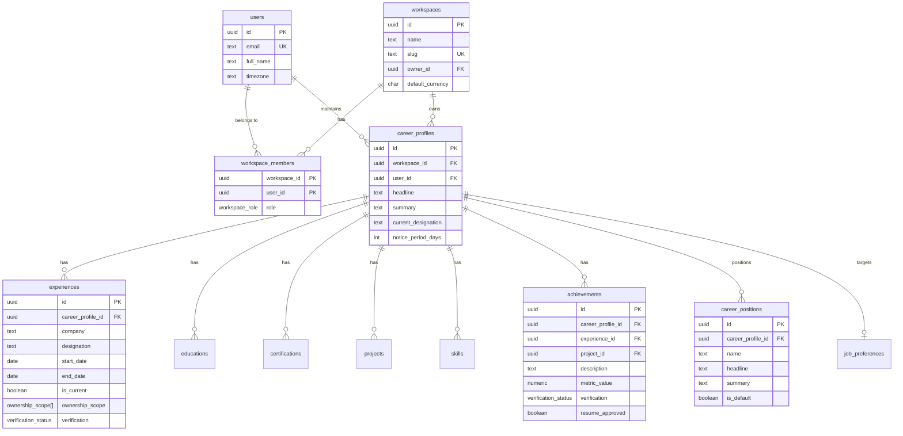
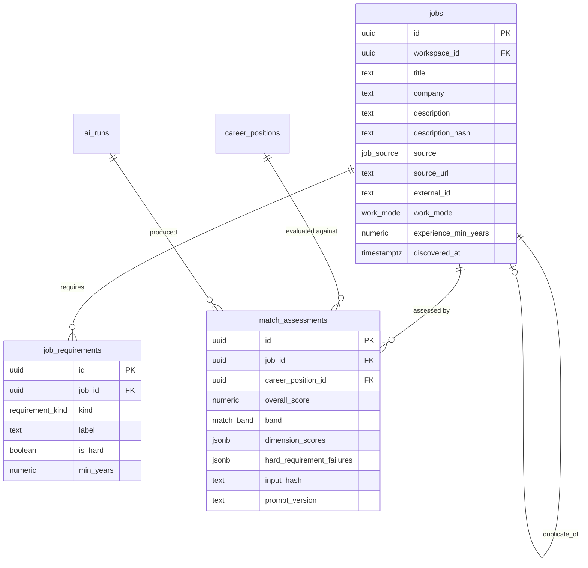
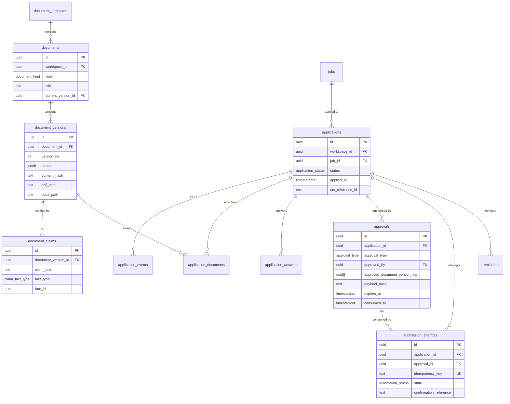
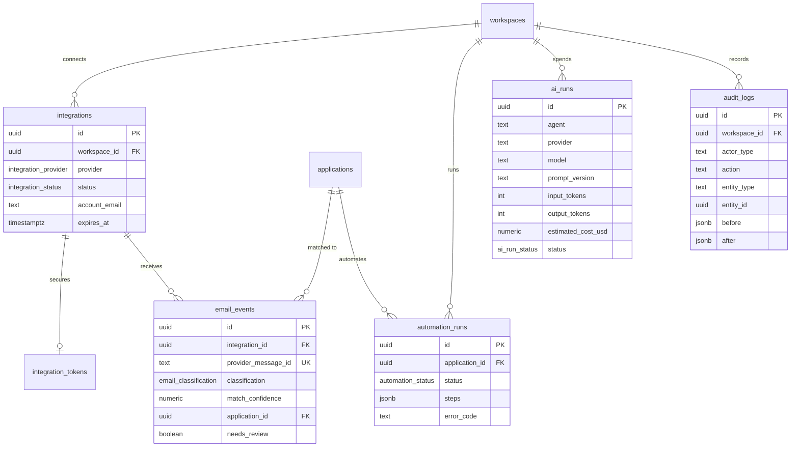
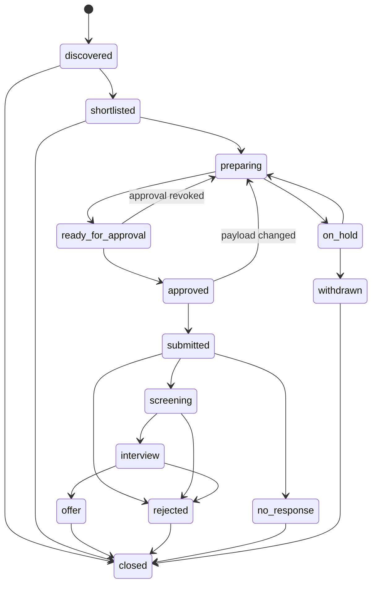

# CareerOS — Database Design

**Status:** Phase 0 deliverable — draft schema awaiting approval
**Engine:** PostgreSQL 16 (Supabase), extensions: `pgcrypto` (UUIDs), `pg_trgm` (fuzzy duplicate
detection), optional `vector` (deferred until embeddings are actually needed)

> The DDL below is the complete proposed schema. It is **not applied anywhere yet**. On approval it
> becomes `supabase/migrations/0001_init.sql` unchanged, plus one migration per subsequent change.
> No schema change is ever made outside a migration.

---

## 1. Conventions

| Convention | Rule |
|---|---|
| Keys | `uuid primary key default gen_random_uuid()` everywhere (spec requirement) |
| Timestamps | `created_at timestamptz not null default now()`, `updated_at` maintained by trigger |
| Tenancy | Every tenant-owned table carries `workspace_id uuid not null` — including child tables |
| Referential integrity | `on delete cascade` for owned children, `restrict` for referenced facts, `set null` for optional links |
| **Cross-tenant safety** | Child tables use **composite foreign keys** `(parent_id, workspace_id) → parent(id, workspace_id)`. A row physically cannot reference a parent in another workspace, even if RLS were bypassed |
| Enums | Native PostgreSQL enums for closed sets (statuses, kinds); `text` + check for open sets |
| Money | `numeric(14,2)` + ISO-4217 `char(3)` currency + explicit period. Never floats |
| Dates | `date` for employment/project dates, `timestamptz` for events |
| Soft deletion | Not used. Archival is an explicit status; deletion cascades or is audited |
| Naming | `snake_case`, plural tables, singular enum types, `<table>_<purpose>_key` for indexes |
| Immutability | Append-only tables have no update/delete policy **and** a trigger that rejects mutation |

---

## 2. Additions to the spec's 25 core tables

The spec's Part 6 lists 25 tables, but several required behaviours have no home in that list. These
ten additions are proposed. Each closes a gap between the table list and Parts 3, 5, 8, 11, and 12.

| # | Table | Gap it closes |
|---|---|---|
| 26 | `educations` | Module 1 requires Education; no table exists in the core list |
| 27 | `certifications` | Module 1 requires Certifications; same gap |
| 28 | `document_templates` | Module 2 requires multiple resume templates with versions |
| 29 | `document_claims` | "Every generated claim must be traceable to the master profile" (Part 5, Module 5) is untestable without a claim→fact link |
| 30 | `submission_attempts` | Part 8 requires idempotency for submission; Part 11 requires duplicate submission prevention and confirmation evidence |
| 31 | `reminders` | Modules 6 and 8 require follow-up reminders |
| 32 | `integration_tokens` | OAuth secrets must not sit in a table readable by `authenticated` (SECURITY §6) |
| 33 | `career_position_skills` | "Priority skills" per positioning profile needs an ordered, referentially valid join |
| 34 | `career_position_projects` | "Relevant projects" per positioning profile |
| 35 | `career_position_achievements` | "Relevant achievements" per positioning profile |

Nothing is removed from the spec's list.

---

## 3. ER diagrams

Split by domain for readability; together they form the complete model.

### 3.1 Identity, tenancy, and profile



### 3.2 Jobs and matching



### 3.3 Documents, applications, approvals



### 3.4 Integrations, AI, and audit



---

## 4. Status model

`application_status` is the core state machine. Transitions are validated in `packages/core`
(a table-driven transition map) **and** recorded in `application_events`. Illegal transitions are
rejected by the service; the database records history rather than guessing.



Rules the schema/domain enforce:
- `submitted` requires: valid unconsumed approval, at least one submitted `application_documents`
  row, and a `submission_attempts` row referencing that approval.
- `approved` is not storable without a live `approvals` row.
- Leaving `submitted` never deletes the submission record.

---

## 5. Full schema (draft migration `0001_init.sql`)

```sql
-- ============================================================================
-- CareerOS — initial schema
-- PostgreSQL 16 / Supabase
-- ============================================================================

create extension if not exists pgcrypto;
create extension if not exists pg_trgm;

-- ---------------------------------------------------------------- enum types
create type public.workspace_role        as enum ('owner','admin','member');
create type public.verification_status   as enum ('verified','user_confirmed','needs_evidence','excluded');
create type public.ownership_scope       as enum ('implementation','technical_decisions','project_coordination','client_communication','product_ownership','people_management');
create type public.work_mode             as enum ('onsite','hybrid','remote','unspecified');
create type public.employment_type       as enum ('full_time','part_time','contract','internship','freelance','unspecified');
create type public.compensation_period   as enum ('annual','monthly','daily','hourly');
create type public.job_source            as enum ('linkedin','naukri','wellfound','instahyre','foundit','indeed','company_site','workday','greenhouse','lever','manual','url_import','file_upload','email_alert','other');
create type public.job_status            as enum ('new','shortlisted','archived','expired','closed');
create type public.requirement_kind      as enum ('skill','experience','education','certification','responsibility','other');
create type public.match_band            as enum ('excellent','strong','possible','low_priority');
create type public.application_status    as enum ('discovered','shortlisted','preparing','ready_for_approval','approved','submitted','screening','interview','offer','rejected','withdrawn','on_hold','closed','no_response');
create type public.application_event_type as enum ('status_change','note','document_attached','approval_granted','approval_revoked','submission_requested','submission_completed','submission_failed','email_received','followup_scheduled','reminder_due');
create type public.document_kind         as enum ('resume','cover_letter','portfolio_brief','outreach_message','interview_brief','other');
create type public.document_status       as enum ('draft','ready','approved','superseded','archived');
create type public.document_engine       as enum ('docx','html_pdf','react_pdf');
create type public.claim_fact_type       as enum ('profile','experience','project','skill','achievement','education','certification');
create type public.approval_type         as enum ('application_submission','document_publish','answer_payload');
create type public.answer_review_state   as enum ('pending','approved','rejected');
create type public.integration_provider  as enum ('gmail','google_calendar','linkedin','naukri','other');
create type public.integration_status    as enum ('pending','active','expired','revoked','error');
create type public.email_classification  as enum ('application_confirmation','rejection','interview_invitation','assessment','recruiter_message','offer','info_request','unrelated','unknown');
create type public.automation_status     as enum ('queued','preparing','awaiting_approval','submitting','submitted','failed','aborted');
create type public.ai_run_status         as enum ('pending','running','succeeded','failed','rejected_by_validation','cancelled');
create type public.reminder_kind         as enum ('follow_up','deadline','stale_application','document_expiry');
create type public.reminder_status       as enum ('pending','notified','dismissed','done');

-- ------------------------------------------------------------- helper funcs
create or replace function public.set_updated_at()
returns trigger language plpgsql as $$
begin
  new.updated_at = now();
  return new;
end;
$$;

create or replace function public.forbid_mutation()
returns trigger language plpgsql as $$
begin
  raise exception 'Table %.% is append-only; updates are not permitted',
    tg_table_schema, tg_table_name using errcode = '42501';
end;
$$;

-- ================================================================== IDENTITY
create table public.users (
  id           uuid primary key references auth.users(id) on delete cascade,
  email        text not null,
  full_name    text,
  avatar_url   text,
  timezone     text not null default 'Asia/Kolkata',
  locale       text not null default 'en-IN',
  created_at   timestamptz not null default now(),
  updated_at   timestamptz not null default now()
);
create unique index users_email_lower_key on public.users (lower(email));

create table public.workspaces (
  id               uuid primary key default gen_random_uuid(),
  name             text not null,
  slug             text not null,
  owner_id         uuid not null references public.users(id) on delete restrict,
  default_currency char(3) not null default 'INR',
  is_personal      boolean not null default true,
  created_at       timestamptz not null default now(),
  updated_at       timestamptz not null default now(),
  constraint workspaces_slug_key unique (slug)
);

create table public.workspace_members (
  workspace_id uuid not null references public.workspaces(id) on delete cascade,
  user_id      uuid not null references public.users(id) on delete cascade,
  role         public.workspace_role not null default 'member',
  created_at   timestamptz not null default now(),
  primary key (workspace_id, user_id)
);
create index workspace_members_user_idx on public.workspace_members (user_id);

-- ========================================================== CAREER PROFILE
create table public.career_profiles (
  id                      uuid primary key default gen_random_uuid(),
  workspace_id            uuid not null references public.workspaces(id) on delete cascade,
  user_id                 uuid not null references public.users(id) on delete cascade,
  full_name               text,
  phone                   text,
  city                    text,
  country                 text not null default 'India',
  headline                text,
  summary                 text,
  current_designation     text,
  current_company         text,
  total_experience_months int check (total_experience_months >= 0),
  notice_period_days      int check (notice_period_days >= 0),
  linkedin_url            text,
  github_url              text,
  portfolio_url           text,
  other_links             jsonb not null default '[]'::jsonb,
  is_primary              boolean not null default true,
  created_at              timestamptz not null default now(),
  updated_at              timestamptz not null default now(),
  constraint career_profiles_workspace_user_key unique (workspace_id, user_id),
  constraint career_profiles_id_workspace_key  unique (id, workspace_id)
);

create table public.experiences (
  id                uuid primary key default gen_random_uuid(),
  workspace_id      uuid not null references public.workspaces(id) on delete cascade,
  career_profile_id uuid not null,
  company           text not null,
  company_url       text,
  designation       text not null,
  employment_type   public.employment_type not null default 'full_time',
  location          text,
  work_mode         public.work_mode not null default 'unspecified',
  start_date        date not null,
  end_date          date,
  is_current        boolean not null default false,
  client_name       text,
  client_involvement text,
  responsibilities  text[] not null default '{}',
  technologies      text[] not null default '{}',
  ownership_scope   public.ownership_scope[] not null default '{}',
  summary           text,
  verification      public.verification_status not null default 'needs_evidence',
  source            text not null default 'manual',
  created_at        timestamptz not null default now(),
  updated_at        timestamptz not null default now(),
  constraint experiences_id_workspace_key unique (id, workspace_id),
  constraint experiences_profile_fk foreign key (career_profile_id, workspace_id)
    references public.career_profiles(id, workspace_id) on delete cascade,
  constraint experiences_dates_chk check (end_date is null or end_date >= start_date),
  constraint experiences_current_chk check (not is_current or end_date is null)
);
create index experiences_profile_idx on public.experiences (career_profile_id, start_date desc);

create table public.projects (
  id                uuid primary key default gen_random_uuid(),
  workspace_id      uuid not null references public.workspaces(id) on delete cascade,
  career_profile_id uuid not null,
  experience_id     uuid,
  name              text not null,
  role              text,
  summary           text,
  description       text,
  url               text,
  start_date        date,
  end_date          date,
  technologies      text[] not null default '{}',
  metrics           jsonb not null default '[]'::jsonb,
  verification      public.verification_status not null default 'needs_evidence',
  created_at        timestamptz not null default now(),
  updated_at        timestamptz not null default now(),
  constraint projects_id_workspace_key unique (id, workspace_id),
  constraint projects_profile_fk foreign key (career_profile_id, workspace_id)
    references public.career_profiles(id, workspace_id) on delete cascade,
  constraint projects_experience_fk foreign key (experience_id, workspace_id)
    references public.experiences(id, workspace_id) on delete set null,
  constraint projects_dates_chk check (end_date is null or start_date is null or end_date >= start_date)
);
create index projects_profile_idx on public.projects (career_profile_id);

create table public.skills (
  id                uuid primary key default gen_random_uuid(),
  workspace_id      uuid not null references public.workspaces(id) on delete cascade,
  career_profile_id uuid not null,
  name              text not null,
  category          text,
  proficiency       smallint check (proficiency between 1 and 5),
  years_experience  numeric(4,1) check (years_experience >= 0),
  last_used         date,
  is_priority       boolean not null default false,
  verification      public.verification_status not null default 'user_confirmed',
  created_at        timestamptz not null default now(),
  updated_at        timestamptz not null default now(),
  constraint skills_id_workspace_key unique (id, workspace_id),
  constraint skills_profile_fk foreign key (career_profile_id, workspace_id)
    references public.career_profiles(id, workspace_id) on delete cascade
);
create unique index skills_profile_name_key on public.skills (career_profile_id, lower(name));

create table public.educations (
  id                uuid primary key default gen_random_uuid(),
  workspace_id      uuid not null references public.workspaces(id) on delete cascade,
  career_profile_id uuid not null,
  institution       text not null,
  degree            text,
  field_of_study    text,
  start_date        date,
  end_date          date,
  grade             text,
  verification      public.verification_status not null default 'user_confirmed',
  created_at        timestamptz not null default now(),
  updated_at        timestamptz not null default now(),
  constraint educations_id_workspace_key unique (id, workspace_id),
  constraint educations_profile_fk foreign key (career_profile_id, workspace_id)
    references public.career_profiles(id, workspace_id) on delete cascade
);

create table public.certifications (
  id                uuid primary key default gen_random_uuid(),
  workspace_id      uuid not null references public.workspaces(id) on delete cascade,
  career_profile_id uuid not null,
  name              text not null,
  issuer            text,
  issued_on         date,
  expires_on        date,
  credential_url    text,
  credential_id     text,
  verification      public.verification_status not null default 'user_confirmed',
  created_at        timestamptz not null default now(),
  updated_at        timestamptz not null default now(),
  constraint certifications_id_workspace_key unique (id, workspace_id),
  constraint certifications_profile_fk foreign key (career_profile_id, workspace_id)
    references public.career_profiles(id, workspace_id) on delete cascade
);

create table public.achievements (
  id                uuid primary key default gen_random_uuid(),
  workspace_id      uuid not null references public.workspaces(id) on delete cascade,
  career_profile_id uuid not null,
  experience_id     uuid,
  project_id        uuid,
  description       text not null,
  metric_value      numeric(12,2),
  metric_unit       text,
  metric_context    text,
  evidence_url      text,
  evidence_note     text,
  verification      public.verification_status not null default 'needs_evidence',
  resume_approved   boolean not null default false,
  approved_by       uuid references public.users(id) on delete set null,
  approved_at       timestamptz,
  source            text not null default 'manual',
  created_at        timestamptz not null default now(),
  updated_at        timestamptz not null default now(),
  constraint achievements_id_workspace_key unique (id, workspace_id),
  constraint achievements_profile_fk foreign key (career_profile_id, workspace_id)
    references public.career_profiles(id, workspace_id) on delete cascade,
  constraint achievements_experience_fk foreign key (experience_id, workspace_id)
    references public.experiences(id, workspace_id) on delete set null,
  constraint achievements_project_fk foreign key (project_id, workspace_id)
    references public.projects(id, workspace_id) on delete set null,
  -- an unverified or excluded achievement can never be approved for resume use
  constraint achievements_approval_chk check (
    not (resume_approved and verification in ('needs_evidence','excluded'))
  ),
  -- a metric must be backed by evidence before it can be approved
  constraint achievements_metric_chk check (
    not (resume_approved and metric_value is not null and evidence_url is null and evidence_note is null)
  )
);
create index achievements_profile_verified_idx
  on public.achievements (career_profile_id) where resume_approved;

create table public.career_positions (
  id                uuid primary key default gen_random_uuid(),
  workspace_id      uuid not null references public.workspaces(id) on delete cascade,
  career_profile_id uuid not null,
  name              text not null,
  slug              text not null,
  headline          text,
  summary           text,
  preferred_titles  text[] not null default '{}',
  target_seniority  text,
  is_default        boolean not null default false,
  created_at        timestamptz not null default now(),
  updated_at        timestamptz not null default now(),
  constraint career_positions_id_workspace_key unique (id, workspace_id),
  constraint career_positions_profile_fk foreign key (career_profile_id, workspace_id)
    references public.career_profiles(id, workspace_id) on delete cascade
);
create unique index career_positions_profile_slug_key
  on public.career_positions (career_profile_id, slug);
create unique index career_positions_one_default_idx
  on public.career_positions (career_profile_id) where is_default;

create table public.career_position_skills (
  workspace_id uuid not null references public.workspaces(id) on delete cascade,
  position_id  uuid not null,
  skill_id     uuid not null,
  rank         int not null default 0,
  primary key (position_id, skill_id),
  constraint cps_position_fk foreign key (position_id, workspace_id)
    references public.career_positions(id, workspace_id) on delete cascade,
  constraint cps_skill_fk foreign key (skill_id, workspace_id)
    references public.skills(id, workspace_id) on delete cascade
);

create table public.career_position_projects (
  workspace_id uuid not null references public.workspaces(id) on delete cascade,
  position_id  uuid not null,
  project_id   uuid not null,
  rank         int not null default 0,
  primary key (position_id, project_id),
  constraint cpp_position_fk foreign key (position_id, workspace_id)
    references public.career_positions(id, workspace_id) on delete cascade,
  constraint cpp_project_fk foreign key (project_id, workspace_id)
    references public.projects(id, workspace_id) on delete cascade
);

create table public.career_position_achievements (
  workspace_id  uuid not null references public.workspaces(id) on delete cascade,
  position_id   uuid not null,
  achievement_id uuid not null,
  rank          int not null default 0,
  primary key (position_id, achievement_id),
  constraint cpa_position_fk foreign key (position_id, workspace_id)
    references public.career_positions(id, workspace_id) on delete cascade,
  constraint cpa_achievement_fk foreign key (achievement_id, workspace_id)
    references public.achievements(id, workspace_id) on delete cascade
);

create table public.job_preferences (
  id                  uuid primary key default gen_random_uuid(),
  workspace_id        uuid not null references public.workspaces(id) on delete cascade,
  career_profile_id   uuid not null,
  target_titles       text[] not null default '{}',
  locations           text[] not null default '{}',
  work_modes          public.work_mode[] not null default '{}',
  employment_types    public.employment_type[] not null default '{}',
  min_compensation    numeric(14,2),
  max_compensation    numeric(14,2),
  currency            char(3) not null default 'INR',
  compensation_period public.compensation_period not null default 'annual',
  willing_to_relocate boolean not null default false,
  notice_period_days  int,
  updated_at          timestamptz not null default now(),
  created_at          timestamptz not null default now(),
  constraint job_preferences_profile_key unique (career_profile_id),
  constraint job_preferences_profile_fk foreign key (career_profile_id, workspace_id)
    references public.career_profiles(id, workspace_id) on delete cascade,
  constraint job_preferences_comp_chk check (
    min_compensation is null or max_compensation is null or max_compensation >= min_compensation
  )
);

-- ================================================================ JOBS
create table public.jobs (
  id                   uuid primary key default gen_random_uuid(),
  workspace_id         uuid not null references public.workspaces(id) on delete cascade,
  career_profile_id    uuid,
  title                text not null,
  company              text not null,
  company_domain       text,
  description          text not null,
  description_hash     text not null,
  dedupe_key           text,
  source               public.job_source not null,
  source_url           text,
  external_id          text,
  location_text        text,
  work_mode            public.work_mode not null default 'unspecified',
  employment_type      public.employment_type not null default 'unspecified',
  experience_min_years numeric(4,1),
  experience_max_years numeric(4,1),
  compensation_min     numeric(14,2),
  compensation_max     numeric(14,2),
  compensation_currency char(3),
  compensation_period  public.compensation_period,
  posted_at            timestamptz,
  discovered_at        timestamptz not null default now(),
  application_deadline date,
  status               public.job_status not null default 'new',
  duplicate_of_job_id  uuid,
  raw_payload          jsonb not null default '{}'::jsonb,
  created_by           uuid references public.users(id) on delete set null,
  created_at           timestamptz not null default now(),
  updated_at           timestamptz not null default now(),
  constraint jobs_id_workspace_key unique (id, workspace_id),
  constraint jobs_profile_fk foreign key (career_profile_id, workspace_id)
    references public.career_profiles(id, workspace_id) on delete cascade,
  constraint jobs_duplicate_fk foreign key (duplicate_of_job_id, workspace_id)
    references public.jobs(id, workspace_id) on delete set null,
  constraint jobs_duplicate_self_chk check (duplicate_of_job_id is null or duplicate_of_job_id <> id),
  constraint jobs_experience_chk check (
    experience_min_years is null or experience_max_years is null
    or experience_max_years >= experience_min_years
  )
);
create unique index jobs_external_ref_key
  on public.jobs (workspace_id, source, external_id) where external_id is not null;
create unique index jobs_source_url_key
  on public.jobs (workspace_id, source_url) where source_url is not null;
create index jobs_discovered_idx on public.jobs (workspace_id, discovered_at desc);
create index jobs_status_idx on public.jobs (workspace_id, status);
create index jobs_dedupe_idx using gin (description_hash gin_trgm_ops);
create index jobs_title_company_trgm_idx
  on public.jobs using gin ((lower(title || ' ' || company)) gin_trgm_ops);

create table public.job_requirements (
  id         uuid primary key default gen_random_uuid(),
  workspace_id uuid not null references public.workspaces(id) on delete cascade,
  job_id     uuid not null,
  kind       public.requirement_kind not null,
  label      text not null,
  is_hard    boolean not null default false,
  min_years  numeric(4,1),
  weight     numeric(4,3) check (weight is null or (weight >= 0 and weight <= 1)),
  details    jsonb not null default '{}'::jsonb,
  created_at timestamptz not null default now(),
  constraint job_requirements_id_workspace_key unique (id, workspace_id),
  constraint job_requirements_job_fk foreign key (job_id, workspace_id)
    references public.jobs(id, workspace_id) on delete cascade
);
create index job_requirements_job_idx on public.job_requirements (job_id, kind);
create index job_requirements_hard_idx on public.job_requirements (job_id) where is_hard;

create table public.match_assessments (
  id                       uuid primary key default gen_random_uuid(),
  workspace_id             uuid not null references public.workspaces(id) on delete cascade,
  job_id                   uuid not null,
  career_position_id       uuid,
  profile_snapshot_hash    text not null,
  overall_score            numeric(5,2) not null check (overall_score between 0 and 100),
  band                     public.match_band not null,
  dimension_scores         jsonb not null default '{}'::jsonb,
  matching_skills          text[] not null default '{}',
  missing_skills           text[] not null default '{}',
  experience_gaps          jsonb not null default '[]'::jsonb,
  seniority_concerns       jsonb not null default '[]'::jsonb,
  hard_requirement_failures jsonb not null default '[]'::jsonb,
  reasons_for              jsonb not null default '[]'::jsonb,
  reasons_against          jsonb not null default '[]'::jsonb,
  confidence               numeric(4,3),
  weights_version          text not null,
  prompt_version           text not null,
  model_provider           text not null,
  model_name               text not null,
  ai_run_id                uuid,
  input_hash               text not null,
  created_at               timestamptz not null default now(),
  constraint match_assessments_id_workspace_key unique (id, workspace_id),
  constraint match_assessments_job_fk foreign key (job_id, workspace_id)
    references public.jobs(id, workspace_id) on delete cascade,
  constraint match_assessments_position_fk foreign key (career_position_id, workspace_id)
    references public.career_positions(id, workspace_id) on delete set null,
  -- a high score must never hide a hard mismatch: the band is capped at 'possible'
  constraint match_assessments_hard_gate_chk check (
    jsonb_array_length(hard_requirement_failures) = 0 or band in ('possible','low_priority')
  )
);
create index match_assessments_job_idx on public.match_assessments (job_id, created_at desc);
create index match_assessments_score_idx on public.match_assessments (workspace_id, overall_score desc);

-- ============================================================ DOCUMENTS
create table public.document_templates (
  id           uuid primary key default gen_random_uuid(),
  workspace_id uuid references public.workspaces(id) on delete cascade,
  key          text not null,
  name         text not null,
  kind         public.document_kind not null,
  engine       public.document_engine not null,
  config       jsonb not null default '{}'::jsonb,
  is_system    boolean not null default false,
  created_at   timestamptz not null default now(),
  updated_at   timestamptz not null default now(),
  constraint document_templates_scope_key unique (workspace_id, key)
);
-- the (workspace_id, key) constraint is ineffective for system rows because
-- workspace_id is then NULL, so enforce key uniqueness separately
create unique index document_templates_system_key
  on public.document_templates (key) where is_system;

create table public.documents (
  id                 uuid primary key default gen_random_uuid(),
  workspace_id       uuid not null references public.workspaces(id) on delete cascade,
  career_profile_id  uuid not null,
  kind               public.document_kind not null,
  title              text not null,
  template_id        uuid,
  is_master          boolean not null default false,
  status             public.document_status not null default 'draft',
  current_version_id uuid,
  created_by         uuid references public.users(id) on delete set null,
  created_at         timestamptz not null default now(),
  updated_at         timestamptz not null default now(),
  constraint documents_id_workspace_key unique (id, workspace_id),
  constraint documents_profile_fk foreign key (career_profile_id, workspace_id)
    references public.career_profiles(id, workspace_id) on delete cascade,
  constraint documents_template_fk foreign key (template_id)
    references public.document_templates(id) on delete set null
);
create index documents_workspace_kind_idx on public.documents (workspace_id, kind, updated_at desc);

create table public.document_versions (
  id                        uuid primary key default gen_random_uuid(),
  workspace_id              uuid not null references public.workspaces(id) on delete cascade,
  document_id               uuid not null,
  version_no                int not null check (version_no > 0),
  content                   jsonb not null,
  content_hash              text not null,
  status                    public.document_status not null default 'draft',
  source_version_id         uuid,
  job_id                    uuid,
  ai_run_id                 uuid,
  pdf_path                  text,
  docx_path                 text,
  rendered_at               timestamptz,
  rendered_bytes            int,
  created_by                uuid references public.users(id) on delete set null,
  created_at                timestamptz not null default now(),
  constraint document_versions_id_workspace_key unique (id, workspace_id),
  constraint document_versions_doc_fk foreign key (document_id, workspace_id)
    references public.documents(id, workspace_id) on delete cascade,
  constraint document_versions_source_fk foreign key (source_version_id, workspace_id)
    references public.document_versions(id, workspace_id) on delete set null,
  constraint document_versions_job_fk foreign key (job_id, workspace_id)
    references public.jobs(id, workspace_id) on delete set null,
  constraint document_versions_doc_no_key unique (document_id, version_no)
);
create index document_versions_doc_idx on public.document_versions (document_id, version_no desc);

alter table public.documents
  add constraint documents_current_version_fk
  foreign key (current_version_id, workspace_id)
  references public.document_versions(id, workspace_id) on delete set null;

create table public.document_claims (
  id                  uuid primary key default gen_random_uuid(),
  workspace_id        uuid not null references public.workspaces(id) on delete cascade,
  document_version_id uuid not null,
  section             text,
  claim_text          text not null,
  fact_type           public.claim_fact_type not null,
  fact_id             uuid,
  fact_path           text,
  created_at          timestamptz not null default now(),
  constraint document_claims_version_fk foreign key (document_version_id, workspace_id)
    references public.document_versions(id, workspace_id) on delete cascade
);
create index document_claims_version_idx on public.document_claims (document_version_id);
create index document_claims_fact_idx on public.document_claims (fact_type, fact_id);

-- ====================================================== APPLICATIONS
create table public.applications (
  id                uuid primary key default gen_random_uuid(),
  workspace_id      uuid not null references public.workspaces(id) on delete cascade,
  career_profile_id uuid not null,
  job_id            uuid not null,
  career_position_id uuid,
  status            public.application_status not null default 'discovered',
  applied_at        timestamptz,
  source            public.job_source not null default 'manual',
  ats_name          text,
  ats_reference_id  text,
  original_url      text,
  outcome           text,
  rejection_reason  text,
  notes             text,
  last_activity_at  timestamptz not null default now(),
  created_by        uuid references public.users(id) on delete set null,
  created_at        timestamptz not null default now(),
  updated_at        timestamptz not null default now(),
  constraint applications_id_workspace_key unique (id, workspace_id),
  constraint applications_profile_fk foreign key (career_profile_id, workspace_id)
    references public.career_profiles(id, workspace_id) on delete cascade,
  constraint applications_job_fk foreign key (job_id, workspace_id)
    references public.jobs(id, workspace_id) on delete cascade,
  constraint applications_position_fk foreign key (career_position_id, workspace_id)
    references public.career_positions(id, workspace_id) on delete set null
);
-- one *active* application per job; re-applying after a rejection is allowed
create unique index applications_active_job_key
  on public.applications (workspace_id, job_id)
  where status not in ('rejected','withdrawn','closed','no_response');
create index applications_status_idx on public.applications (workspace_id, status);
create index applications_applied_idx on public.applications (workspace_id, applied_at desc);

create table public.application_events (
  id             uuid primary key default gen_random_uuid(),
  workspace_id   uuid not null references public.workspaces(id) on delete cascade,
  application_id uuid not null,
  event_type     public.application_event_type not null,
  from_status    public.application_status,
  to_status      public.application_status,
  summary        text,
  payload        jsonb not null default '{}'::jsonb,
  actor_user_id  uuid references public.users(id) on delete set null,
  actor_type     text not null default 'user',
  occurred_at    timestamptz not null default now(),
  created_at     timestamptz not null default now(),
  constraint application_events_app_fk foreign key (application_id, workspace_id)
    references public.applications(id, workspace_id) on delete cascade
);
create index application_events_app_idx on public.application_events (application_id, occurred_at);

create table public.application_documents (
  id                  uuid primary key default gen_random_uuid(),
  workspace_id        uuid not null references public.workspaces(id) on delete cascade,
  application_id      uuid not null,
  document_version_id uuid not null,
  role                public.document_kind not null,
  content_hash        text not null,
  is_submitted        boolean not null default false,
  submitted_at        timestamptz,
  created_at          timestamptz not null default now(),
  constraint application_documents_id_workspace_key unique (id, workspace_id),
  constraint application_documents_app_fk foreign key (application_id, workspace_id)
    references public.applications(id, workspace_id) on delete cascade,
  constraint application_documents_version_fk foreign key (document_version_id, workspace_id)
    references public.document_versions(id, workspace_id) on delete restrict,
  constraint application_documents_unique_key
    unique (application_id, document_version_id, role),
  constraint application_documents_submitted_chk check (
    (is_submitted and submitted_at is not null) or (not is_submitted)
  )
);
create index application_documents_app_idx on public.application_documents (application_id);

create table public.application_answers (
  id             uuid primary key default gen_random_uuid(),
  workspace_id   uuid not null references public.workspaces(id) on delete cascade,
  application_id uuid not null,
  question_text  text not null,
  answer_text    text,
  answer_json    jsonb,
  is_sensitive   boolean not null default false,
  source         text not null default 'user',
  review_state   public.answer_review_state not null default 'pending',
  reviewed_by    uuid references public.users(id) on delete set null,
  reviewed_at    timestamptz,
  created_at     timestamptz not null default now(),
  updated_at     timestamptz not null default now(),
  constraint application_answers_app_fk foreign key (application_id, workspace_id)
    references public.applications(id, workspace_id) on delete cascade,
  -- sensitive/legal declarations can never be auto-approved
  constraint application_answers_sensitive_chk check (
    not (is_sensitive and source = 'ai_suggested' and review_state = 'approved' and reviewed_at is null)
  )
);
create index application_answers_app_idx on public.application_answers (application_id);

create table public.approvals (
  id                            uuid primary key default gen_random_uuid(),
  workspace_id                  uuid not null references public.workspaces(id) on delete cascade,
  application_id                uuid not null,
  approval_type                 public.approval_type not null,
  approved_by                   uuid not null references public.users(id) on delete restrict,
  approved_document_version_ids uuid[] not null default '{}',
  payload_hash                  text not null,
  payload                       jsonb not null,
  expires_at                    timestamptz not null,
  consumed_at                   timestamptz,
  revoked_at                    timestamptz,
  revoked_by                    uuid references public.users(id) on delete set null,
  created_at                    timestamptz not null default now(),
  constraint approvals_id_workspace_key unique (id, workspace_id),
  constraint approvals_app_fk foreign key (application_id, workspace_id)
    references public.applications(id, workspace_id) on delete cascade,
  constraint approvals_expiry_chk check (expires_at > created_at),
  constraint approvals_consumed_chk check (consumed_at is null or consumed_at >= created_at),
  constraint approvals_revoked_chk check (revoked_at is null or revoked_at >= created_at)
);
-- at most one live (unconsumed, unrevoked) approval of each type per application
create unique index approvals_one_live_per_app_key
  on public.approvals (application_id, approval_type)
  where consumed_at is null and revoked_at is null;
create index approvals_app_idx on public.approvals (application_id, created_at desc);

create table public.submission_attempts (
  id                          uuid primary key default gen_random_uuid(),
  workspace_id                uuid not null references public.workspaces(id) on delete cascade,
  application_id              uuid not null,
  approval_id                 uuid,
  idempotency_key             text not null,
  state                       public.automation_status not null default 'queued',
  target_url                  text,
  request_payload_hash        text not null,
  response_status             int,
  confirmation_reference      text,
  confirmation_screenshot_path text,
  error_code                  text,
  error_detail                text,
  started_at                  timestamptz,
  completed_at                timestamptz,
  created_at                  timestamptz not null default now(),
  constraint submission_attempts_id_workspace_key unique (id, workspace_id),
  constraint submission_attempts_app_fk foreign key (application_id, workspace_id)
    references public.applications(id, workspace_id) on delete cascade,
  constraint submission_attempts_approval_fk foreign key (approval_id, workspace_id)
    references public.approvals(id, workspace_id) on delete restrict
);
create unique index submission_attempts_idempotency_key
  on public.submission_attempts (idempotency_key);
-- a single approval may be consumed by exactly one attempt
create unique index submission_attempts_approval_key
  on public.submission_attempts (approval_id) where approval_id is not null;

create table public.reminders (
  id             uuid primary key default gen_random_uuid(),
  workspace_id   uuid not null references public.workspaces(id) on delete cascade,
  application_id uuid,
  kind           public.reminder_kind not null,
  due_at         timestamptz not null,
  status         public.reminder_status not null default 'pending',
  note           text,
  created_at     timestamptz not null default now(),
  updated_at     timestamptz not null default now(),
  constraint reminders_app_fk foreign key (application_id, workspace_id)
    references public.applications(id, workspace_id) on delete cascade
);
create index reminders_due_idx on public.reminders (workspace_id, due_at) where status = 'pending';

-- ====================================================== INTEGRATIONS
create table public.integrations (
  id                  uuid primary key default gen_random_uuid(),
  workspace_id        uuid not null references public.workspaces(id) on delete cascade,
  provider            public.integration_provider not null,
  account_email       text,
  external_account_id text,
  status              public.integration_status not null default 'pending',
  scopes              text[] not null default '{}',
  expires_at          timestamptz,
  last_synced_at      timestamptz,
  last_error          text,
  created_by          uuid references public.users(id) on delete set null,
  created_at          timestamptz not null default now(),
  updated_at          timestamptz not null default now(),
  constraint integrations_id_workspace_key unique (id, workspace_id),
  constraint integrations_scope_key unique (workspace_id, provider, account_email)
);

-- secrets live apart from the user-readable integrations row
create table public.integration_tokens (
  id                uuid primary key default gen_random_uuid(),
  workspace_id      uuid not null references public.workspaces(id) on delete cascade,
  integration_id    uuid not null,
  access_token_enc  bytea,
  refresh_token_enc bytea,
  token_type        text,
  scope             text,
  expires_at        timestamptz,
  key_version       int not null default 1,
  vault_secret_id   uuid,
  created_at        timestamptz not null default now(),
  updated_at        timestamptz not null default now(),
  constraint integration_tokens_integration_fk foreign key (integration_id, workspace_id)
    references public.integrations(id, workspace_id) on delete cascade,
  constraint integration_tokens_integration_key unique (integration_id)
);

create table public.email_events (
  id                        uuid primary key default gen_random_uuid(),
  workspace_id              uuid not null references public.workspaces(id) on delete cascade,
  integration_id            uuid not null,
  provider_message_id       text not null,
  thread_id                 text,
  received_at               timestamptz not null,
  from_address              text,
  to_addresses              text[] not null default '{}',
  subject                   text,
  snippet                   text,
  classification            public.email_classification not null default 'unknown',
  classification_confidence numeric(4,3),
  application_id            uuid,
  match_confidence          numeric(4,3),
  needs_review              boolean not null default false,
  reviewed_by               uuid references public.users(id) on delete set null,
  reviewed_at               timestamptz,
  raw_storage_path          text,
  ai_run_id                 uuid,
  created_at                timestamptz not null default now(),
  constraint email_events_integration_fk foreign key (integration_id, workspace_id)
    references public.integrations(id, workspace_id) on delete cascade,
  constraint email_events_app_fk foreign key (application_id, workspace_id)
    references public.applications(id, workspace_id) on delete set null
);
create unique index email_events_provider_message_key
  on public.email_events (integration_id, provider_message_id);
create index email_events_app_idx on public.email_events (application_id, received_at desc);
create index email_events_review_idx on public.email_events (workspace_id) where needs_review;

-- ===================================================== AUTOMATION / AI
create table public.automation_runs (
  id            uuid primary key default gen_random_uuid(),
  workspace_id  uuid not null references public.workspaces(id) on delete cascade,
  application_id uuid,
  worker        text not null,
  runner_version text,
  status        public.automation_status not null default 'queued',
  target_url    text,
  current_step  text,
  steps         jsonb not null default '[]'::jsonb,
  artifacts     jsonb not null default '[]'::jsonb,
  error_code    text,
  error_detail  text,
  started_at    timestamptz,
  finished_at   timestamptz,
  created_at    timestamptz not null default now(),
  constraint automation_runs_app_fk foreign key (application_id, workspace_id)
    references public.applications(id, workspace_id) on delete cascade
);
create index automation_runs_app_idx on public.automation_runs (application_id, created_at desc);

create table public.ai_runs (
  id                    uuid primary key default gen_random_uuid(),
  workspace_id          uuid not null references public.workspaces(id) on delete cascade,
  agent                 text not null,
  task                  text not null,
  provider              text not null,
  model                 text not null,
  prompt_key            text not null,
  prompt_version        text not null,
  related_job_id        uuid,
  related_document_id   uuid,
  related_application_id uuid,
  input_hash            text not null,
  input_tokens          int,
  output_tokens         int,
  estimated_cost_usd    numeric(12,6),
  duration_ms           int,
  status                public.ai_run_status not null default 'pending',
  validation            jsonb not null default '{}'::jsonb,
  error_code            text,
  error_detail          text,
  created_at            timestamptz not null default now(),
  completed_at          timestamptz
);
create index ai_runs_workspace_idx on public.ai_runs (workspace_id, created_at desc);
create index ai_runs_task_idx on public.ai_runs (workspace_id, task, status);

create table public.audit_logs (
  id            uuid primary key default gen_random_uuid(),
  workspace_id  uuid references public.workspaces(id) on delete cascade,
  actor_user_id uuid references public.users(id) on delete set null,
  actor_type    text not null default 'user',
  action        text not null,
  entity_type   text not null,
  entity_id     uuid,
  before        jsonb,
  after         jsonb,
  ip            inet,
  user_agent    text,
  created_at    timestamptz not null default now()
);
create index audit_logs_entity_idx on public.audit_logs (entity_type, entity_id, created_at desc);
create index audit_logs_workspace_idx on public.audit_logs (workspace_id, created_at desc);

-- --------------------------------------------------- immutability triggers
-- These block UPDATE (rewriting history). DELETE is blocked for `authenticated`
-- by RLS having no delete policy; it remains possible for the trusted
-- privileged-maintenance role used by account deletion (see §13).

create trigger match_assessments_immutable
  before update on public.match_assessments
  for each row execute function public.forbid_mutation();

create trigger application_events_immutable
  before update on public.application_events
  for each row execute function public.forbid_mutation();

create trigger audit_logs_immutable
  before update on public.audit_logs
  for each row execute function public.forbid_mutation();

create or replace function public.prevent_submitted_version_mutation()
returns trigger language plpgsql as $$
begin
  -- privileged maintenance (workspace/account deletion) may remove rows;
  -- it must run inside a transaction that sets this flag explicitly.
  if coalesce(current_setting('careeros.privileged_maintenance', true), 'off') = 'on' then
    if tg_op = 'DELETE' then return old; end if;
    return new;
  end if;

  if exists (
    select 1 from public.application_documents ad
    where ad.document_version_id = old.id and ad.is_submitted
  ) then
    raise exception 'Document version % has been submitted and is immutable', old.id
      using errcode = '42501';
  end if;
  if tg_op = 'DELETE' then
    return old;
  end if;
  return new;
end;
$$;

create trigger document_versions_submitted_immutable
  before update or delete on public.document_versions
  for each row execute function public.prevent_submitted_version_mutation();

-- ------------------------------------------------------------ updated_at
do $$
declare t text;
begin
  foreach t in array array[
    'users','workspaces','career_profiles','experiences','projects','skills','educations',
    'certifications','achievements','career_positions','job_preferences','jobs',
    'document_templates','documents','applications','application_answers','reminders',
    'integrations','integration_tokens'
  ] loop
    execute format(
      'create trigger %I_updated_at before update on public.%I
       for each row execute function public.set_updated_at()', t, t);
  end loop;
end $$;
```

---

## 6. Row Level Security

RLS is enabled on **every** table. Default posture is deny: no policy means no access.

### 6.1 Helper functions

```sql
create or replace function public.is_workspace_member(ws uuid)
returns boolean
language sql stable security definer
set search_path = public, pg_temp
as $$
  select exists (
    select 1 from public.workspace_members m
    where m.workspace_id = ws and m.user_id = auth.uid()
  );
$$;

create or replace function public.workspace_role_of(ws uuid)
returns public.workspace_role
language sql stable security definer
set search_path = public, pg_temp
as $$
  select m.role from public.workspace_members m
  where m.workspace_id = ws and m.user_id = auth.uid()
  limit 1;
$$;

revoke all on function public.is_workspace_member(uuid) from public;
revoke all on function public.workspace_role_of(uuid) from public;
grant execute on function public.is_workspace_member(uuid) to authenticated;
grant execute on function public.workspace_role_of(uuid) to authenticated;
```

`security definer` is required so the membership check can read `workspace_members` without
recursion into its own policy. Both functions are `stable`, take only a UUID, and return a boolean
or role — they cannot be used to read arbitrary rows.

### 6.2 Standard tenant policy pattern

Applied to every workspace-scoped table that has no stricter requirement:

```sql
alter table public.jobs enable row level security;

create policy jobs_select on public.jobs for select to authenticated
  using (public.is_workspace_member(workspace_id));
create policy jobs_insert on public.jobs for insert to authenticated
  with check (public.is_workspace_member(workspace_id));
create policy jobs_update on public.jobs for update to authenticated
  using (public.is_workspace_member(workspace_id))
  with check (public.is_workspace_member(workspace_id));
create policy jobs_delete on public.jobs for delete to authenticated
  using (public.is_workspace_member(workspace_id));
```

The same four-policy block is applied to: `career_profiles`, `experiences`, `projects`, `skills`,
`educations`, `certifications`, `achievements`, `career_positions`, `career_position_*`,
`job_preferences`, `jobs`, `job_requirements`, `documents`, `document_versions`, `document_claims`,
`document_templates` (scoped variant), `applications`, `application_documents`,
`application_answers`, `approvals`, `submission_attempts`, `reminders`, `integrations`,
`email_events`, `automation_runs`, `ai_runs`.

It is generated in the migration by a single loop over that table list, so the policy text cannot
drift between tables.

### 6.3 Tables with stricter policies

| Table | Policy |
|---|---|
| `users` | select/update only for `id = auth.uid()`; insert only via the signup trigger |
| `workspaces` | select for members; update/delete only for `workspace_role_of(id) in ('owner','admin')` |
| `workspace_members` | select for members; insert/delete only for `owner`/`admin`; a user may not escalate their own role |
| `match_assessments` | select/insert for members; **no update/delete** (append-only trigger also blocks it) |
| `application_events` | select/insert for members; no update/delete |
| `audit_logs` | select for members (own workspace); **no insert/update/delete** for `authenticated` — written only by the service role |
| `integration_tokens` | **no policy at all** for `authenticated`; additionally `revoke all on public.integration_tokens from anon, authenticated`. Readable only by the service role |
| `document_templates` | rows with `is_system = true` are readable by everyone authenticated; workspace rows follow the standard pattern |
| `document_versions` | update blocked once a version is submitted (trigger); delete blocked for submitted versions |

### 6.4 Storage policies

Buckets: `resumes` (uploads), `documents` (rendered artifacts), `evidence` (achievement proof),
`automation` (screenshots/traces). All **private**. Object keys are
`{workspace_id}/{entity_id}/{filename}`.

```sql
create policy storage_tenant_read on storage.objects for select to authenticated
  using (
    bucket_id in ('resumes','documents','evidence','automation')
    and public.is_workspace_member(((storage.foldername(name))[1])::uuid)
  );

create policy storage_tenant_write on storage.objects for insert to authenticated
  with check (
    bucket_id in ('resumes','documents','evidence','automation')
    and public.is_workspace_member(((storage.foldername(name))[1])::uuid)
  );

create policy storage_tenant_delete on storage.objects for delete to authenticated
  using (
    bucket_id in ('resumes','documents','evidence','automation')
    and public.is_workspace_member(((storage.foldername(name))[1])::uuid)
  );
```

Downloads for the browser use short-lived signed URLs; no bucket is public. The worker uses the
service role and therefore bypasses these policies deliberately — it is the trusted path.

---

## 7. Index strategy

| Purpose | Index |
|---|---|
| Tenant scoping on every table | `(workspace_id)` or `(workspace_id, <cursor>)` composite |
| Job discovery feed | `jobs (workspace_id, discovered_at desc)` |
| Application board | `applications (workspace_id, status)` |
| Match ranking | `match_assessments (workspace_id, overall_score desc)` |
| Resume usage on applications | `application_documents (application_id)` |
| Duplicate detection | trigram GIN on `description_hash` and `lower(title || ' ' || company)` |
| Approval lookup | partial unique on live approvals; `approvals (application_id, created_at desc)` |
| Idempotency | unique `submission_attempts (idempotency_key)`, unique `(approval_id)` |
| Email dedupe | unique `email_events (integration_id, provider_message_id)` |
| Review queue | partial on `email_events where needs_review` |
| Reminder sweep | partial on `reminders (workspace_id, due_at) where status='pending'` |
| Immutable history reads | `application_events (application_id, occurred_at)` |

Every FK column is indexed. Partial indexes are used wherever the query filters on a status, which
keeps them small.

---

## 8. Invariants the schema enforces

These are database-level guarantees, not conventions, so a coding mistake cannot produce them:

1. **Tenant coherence** — composite FKs make cross-workspace references impossible.
2. **Approval is not a boolean** — `approvals` carries application, type, approver, timestamp,
   approved document version IDs, payload hash, expiry, and consumption. At most one live approval
   of each type per application.
3. **One approval, one submission** — unique `submission_attempts.approval_id` plus unique
   `idempotency_key` make duplicate submission structurally impossible.
4. **No unverified achievements on a resume** — `achievements_approval_chk`.
5. **A metric without evidence cannot be approved** — `achievements_metric_chk`.
6. **Hard mismatches cannot hide behind a good score** — `match_assessments_hard_gate_chk` caps the
   band when `hard_requirement_failures` is non-empty.
7. **Submitted documents are immutable** — trigger on `document_versions`.
8. **Assessments, events, and audit logs cannot be rewritten** — append-only triggers.
9. **Sensitive answers are never auto-approved.**
10. **Only one default career position per profile** — partial unique index.
11. **Employment dates are sane** — `end_date >= start_date`, current roles have no end date.
12. **At most one *active* application per job per workspace** — terminal rows (`rejected`,
    `withdrawn`, `closed`, `no_response`) do not block re-applying after a rejection.

### 8.1 Privileged deletion

Account and workspace deletion intentionally removes everything, including append-only rows. Because
`application_documents` uses `on delete restrict` against `document_versions`, and because submitted
versions are otherwise immutable, deletion runs as an explicit function rather than a bare `DELETE`:

```sql
create or replace function public.delete_workspace_privileged(p_workspace_id uuid)
returns void language plpgsql security definer
set search_path = public, pg_temp
as $$
begin
  if not public.is_workspace_member(p_workspace_id)
     and coalesce(current_setting('careeros.privileged_maintenance', true), 'off') <> 'on' then
    raise exception 'not authorised';
  end if;

  perform set_config('careeros.privileged_maintenance', 'on', true);

  -- order matters: children first, then the workspace itself
  delete from public.application_documents where workspace_id = p_workspace_id;
  delete from public.applications        where workspace_id = p_workspace_id;
  delete from public.documents           where workspace_id = p_workspace_id;  -- cascades versions
  delete from public.jobs                where workspace_id = p_workspace_id;
  delete from public.workspaces          where id = p_workspace_id;            -- cascades the rest

  perform set_config('careeros.privileged_maintenance', 'off', true);
end;
$$;
```

Storage objects are removed separately by a worker, since they live outside SQL. Phase 7 tests must
prove that deletion is complete (no orphaned rows, no orphaned objects) and that the receipt is logged.

---

## 9. Migration workflow

```
supabase/migrations/0001_init.sql        schema + RLS + triggers + indexes
supabase/migrations/0002_seed_ref.sql    reference data (document templates, system rows)
supabase/migrations/0003_views.sql       analytics views (Phase 6)
```

- One owner: the Supabase CLI. No dashboard edits to production schema.
- Rules: forward-only; every migration is idempotent-safe where practical (`if not exists`); no
  destructive change without a paired data-migration step; RLS is enabled in the same migration that
  creates a table, never "later".
- Types are regenerated after every migration: `supabase gen types typescript --linked > packages/database/src/database.types.ts`.
- Local verification: a disposable Postgres container (or `supabase start`) applies migrations from
  scratch on every CI run, which proves the schema is reproducible.
- No `psql` is installed on the host; the CLI and `docker exec` are the supported paths (see
  `ENVIRONMENT_AUDIT.md §2`).

---

## 10. Tests this schema must pass (Phase 1–4)

| Test | Method |
|---|---|
| Cross-tenant read returns zero rows | Insert two workspaces, query as a member of one |
| Cross-tenant write is rejected | Attempt insert referencing another workspace's profile |
| RLS enabled everywhere | `select relname from pg_class where relrowsecurity = false` returns no app tables |
| Approval cannot be consumed twice | Two concurrent submission attempts → one wins, one raises |
| Expired approval rejected | Insert with past `expires_at`, attempt consumption |
| Changed payload invalidates approval | Mutate document version ID set → hash mismatch |
| Submitted document cannot be edited | Update `content` → trigger raises |
| Assessment cannot be updated | Update `overall_score` → trigger raises |
| Unverified achievement cannot be approved | Insert with `resume_approved = true` → check violation |
| Hard mismatch caps the band | Insert `excellent` with non-empty failures → check violation |
| Analytics correctness | Funnel counts against a fixture dataset |

---

## 11. Open decisions affecting the schema

| ID | Question | Effect |
|---|---|---|
| D1 | Supabase cloud project or local only | Where migrations are applied first |
| D3 | Query layer (recommended: generated types + SQL) | Whether `drizzle-orm` schemas duplicate this DDL |
| D7 | Gmail scope set | Columns in `integrations`/`email_events` are sufficient for either choice |
| D12 | Single personal workspace vs multi-workspace UI | Schema supports both; only UI and onboarding differ |
| D13 | Compensation defaults (currency, period) | Defaults chosen: `INR`, `annual`, both configurable |
