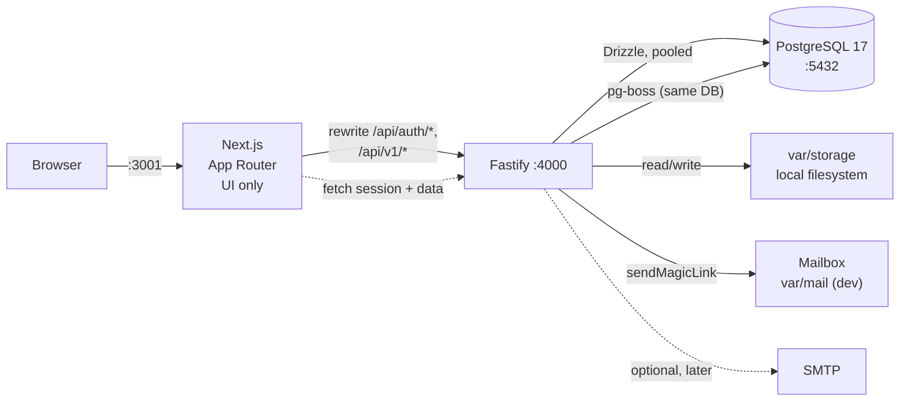

# CareerOS — Local-First Architecture (Post-Supabase)

**Status:** Proposed — awaiting approval. Nothing in this document is implemented yet.
**Supersedes:** the Supabase runtime portions of `docs/ARCHITECTURE.md` (the module boundaries,
layering rules, AI architecture, document engine, approval design, and scoring design all still
stand).

---

## 1. Summary

```
Browser ──► Next.js (UI, :3001) ──rewrite──► Fastify API (:4000) ──► PostgreSQL 17 (:5432)
                                                     │
                                                     ├── Better Auth (auth schema)
                                                     ├── Drizzle ORM (migrations + queries)
                                                     ├── Local filesystem storage (var/storage)
                                                     └── pg-boss (jobs, same Postgres)
```

- **One database**, one process for the API, one for the UI. No Redis, no cloud dependency, no
  mandatory external hosting.
- **Next.js becomes UI-only.** It renders pages and calls the API. It never touches PostgreSQL and
  has no database driver installed.
- **Fastify is the trust boundary.** Authentication, authorization, validation, and data access all
  live there.
- **PostgreSQL still defends itself.** The RLS policies are preserved as a second layer, driven by
  request-scoped claims set inside a transaction.
- **Supabase disappears from the runtime**; its migration files and volumes are archived, not
  deleted.

---

## 2. Why this shape

| Requirement | How it is met |
|---|---|
| Local-first, self-hosted | Everything runs in Docker/Node on the machine; no managed service |
| No Redis | pg-boss uses the existing PostgreSQL for queues, scheduling and retries |
| No cloud backend / hosting | No Vercel/Supabase/Inngest dependency in the runtime path |
| Keep Phase 1 UI | Next.js app and all components are retained; only the data/auth layer is rewired |
| Keep AI architecture | `packages/ai` is untouched — it never depended on Supabase |
| Keep validation schemas | `packages/validation` is untouched |
| Separate backend API | Fastify app with versioned `/api/v1` routes |
| No DB access in React | Enforced by removing the driver from `apps/web` and by lint rules |

---

## 3. Runtime topology



Ports: web **3001** (3000 is occupied on this machine), API **4000**, PostgreSQL **5432** (verified
free; see §9), no Supabase ports in use after decommission.

---

## 4. Repository structure

```
careeros/
├─ apps/
│  ├─ web/                        # Next.js 16 — UI only (existing, rewired)
│  │  └─ src/
│  │     ├─ app/                  # pages call the API, never the DB
│  │     ├─ components/           # unchanged
│  │     ├─ features/             # unchanged forms; auth form uses Better Auth client
│  │     └─ lib/
│  │        ├─ api-client.ts      # server + client fetch with cookie forwarding
│  │        ├─ auth-client.ts     # better-auth/react client
│  │        └─ session.ts         # cookie-presence gate for proxy.ts
│  └─ api/                        # Fastify 5 (new deployable/process)
│     ├─ src/
│     │  ├─ app.ts                # buildApp() → Fastify instance (testable via inject)
│     │  ├─ server.ts             # listen
│     │  ├─ worker.ts             # pg-boss entry (optional separate process)
│     │  ├─ config/env.ts         # Zod-validated environment
│     │  ├─ plugins/              # db, auth, errors, logging, security, rate-limit
│     │  ├─ routes/
│     │  │  ├─ auth.ts            # Better Auth catch-all /api/auth/*
│     │  │  └─ v1/                # session, profile, health, files
│     │  ├─ services/             # orchestration over packages/core
│     │  ├─ email/                # Mailbox abstraction (file transport)
│     │  └─ jobs/                 # pg-boss handlers
│     └─ package.json
├─ packages/
│  ├─ core/                       # domain rules (existing, Ctx instead of SupabaseClient)
│  ├─ validation/                 # existing Zod schemas (unchanged)
│  ├─ ai/                         # existing provider abstraction (unchanged)
│  ├─ database/                   # Drizzle schema, client, repositories, migrations
│  └─ storage/                    # local filesystem adapter + signed URLs (new)
├─ drizzle/                       # generated SQL migrations (via drizzle-kit)
├─ docker-compose.yml             # PostgreSQL 17 with a named volume
├─ var/                           # runtime data (gitignored): storage/, mail/
├─ backups/                       # pg_dump archives (gitignored)
└─ supabase/                      # ARCHIVED, untouched (see §11)
```

`apps/worker` is deliberately *not* a separate package yet: the worker entrypoint lives in
`apps/api/src/worker.ts`, so the process can be split without moving code.

---

## 5. Authentication

### 5.1 Verified compatibility (before committing to it)

| Question | Verified answer | Source |
|---|---|---|
| Does Better Auth support Fastify? | **Yes** — official integration guide: catch-all `/api/auth/*` route using `auth.handler()` and `fromNodeHeaders` | better-auth.com/docs/integrations/fastify (page states Latest Version 1.7.19) |
| Current version | `better-auth@1.7.19` | npm registry |
| Drizzle adapter | Separate package `@better-auth/drizzle-adapter@1.7.19` | npm registry |
| Adapter peer requirements | `drizzle-orm ^0.45.2` (we have 0.45.4), `@better-auth/core ^1.7.19`, `@better-auth/utils ^0.4.2 \|\| ^0.5.0` | npm registry |
| Database driver | `pg ^8.0.0` peer (we have 8.23.1) | npm registry |
| Next.js/React peers | `next ^16`, `react ^19` — both satisfied | npm registry |
| Vitest peer | `^5.0.0` — satisfied | npm registry |
| Magic link plugin | **Yes** — `better-auth/plugins` `magicLink({ sendMagicLink })`, `expiresIn` default 300 s, atomic single-use token | better-auth.com/docs/plugins/magic-link |
| UUID primary keys | **Yes** — `advanced.database.generateId: "uuid"` | better-auth.com/docs/concepts/database |
| Provisioning hook | **Yes** — `databaseHooks.user.create.after` runs after commit | better-auth.com/docs/concepts/database |
| Non-default schema | **Yes** — Drizzle adapter `schemaName: "auth"` | better-auth.com/docs/adapters/drizzle |
| Session lookup for API routes | **Yes** — `auth.api.getSession({ headers: fromNodeHeaders(request.headers) })` | Fastify guide |

**Not yet verified:** that the whole flow works at runtime with our exact pinned versions. Version
metadata and documentation are not a substitute for a running test. This is why the plan opens with
a **Stage 0 compatibility spike** whose only deliverable is a proven magic-link round trip. No
migration work is committed until it passes.

### 5.2 Design

- **Method:** magic link (preserves the current passwordless UX and the "no password storage" property).
- **Tables:** Better Auth owns `auth.user`, `auth.session`, `auth.account`, `auth.verification`.
  Keeping them in an `auth` schema mirrors the old layout and keeps `public.*` for application data.
- **IDs:** `advanced.database.generateId: "uuid"` so `auth.user.id` is a UUID and every existing
  `public.*` UUID reference remains valid.
- **Application user row:** `public.users` stays as the application profile record, with
  `id` referencing `auth.user(id)` (replacing today's `references auth.users(id)`). This preserves
  the existing schema shape and the one-row-per-user assumption.
- **Session transport:** Better Auth's cookie, `HttpOnly`, `SameSite=Lax`, `Secure` in production.
  The browser only ever talks to `localhost:3001` because of the Next rewrite, so there is no
  cross-origin cookie problem.
- **Sign-in endpoints:** `POST /api/auth/sign-in/magic-link`, `GET /api/auth/magic-link/verify`
  (via the proxy), plus `GET /api/v1/session` exposing the resolved workspace context.
- **Sign-out:** `POST /api/auth/sign-out`.
- **Email delivery:** a `Mailbox` abstraction with:
  - `file` transport (default, local): writes `.json` + `.html` to `var/mail/` and logs the link;
  - `console` transport (tests);
  - `smtp` transport (optional, later — not required for local-first).
  A dev-only `GET /dev/mail` route lists captured messages; it is hard-disabled when
  `NODE_ENV=production`.
- **Password auth later:** add the `emailAndPassword` provider; the `account` table already supports
  a `credential` provider, so no schema redesign is needed.

### 5.3 Provisioning (replaces the database trigger)

The Supabase trigger cannot survive — `auth.users` is gone. Replacement:

1. Better Auth `databaseHooks.user.create.after` calls `provisionUser(userId, email, name)`.
2. `provisionUser` runs in one transaction, keyed by `pg_advisory_xact_lock(hashtext(userId))`, and
   performs idempotent inserts: workspace → owner membership → empty career profile.
3. The session resolver also calls `ensureWorkspace(userId)` when no membership exists (lazy
   fallback). This covers the gap where the `after` hook runs post-commit and the process dies
   between commit and provisioning.
4. Both paths are safe to run concurrently because of the advisory lock plus `ON CONFLICT DO NOTHING`.

This is *stronger* than the trigger in one respect (it is retryable) and *weaker* in another
(it is not transactional with user creation), which is exactly why the lazy fallback exists.

---

## 6. Authorization (translating Supabase)

Today authorization is enforced twice: application filters **and** RLS using `auth.uid()`. Both are
preserved.

### 6.1 Layer 1 — application authorization (primary)

- A Fastify `auth` plugin resolves the session, then loads the user's workspace membership and
  attaches `request.ctx = { userId, email, workspaceId, role }`.
- Every service function takes that `Ctx` explicitly. Every repository query is scoped by
  `ctx.workspaceId`. A `workspace_id` in a request body or query string is **never** trusted; it can
  only *select among* memberships the user already has.
- Role checks live in one permission map in `packages/core`, not scattered across routes.
- `401` for no session, `403` for a workspace the user does not belong to, `404` for rows that exist
  in another workspace (never confirm existence across tenants).

### 6.2 Layer 2 — PostgreSQL defense-in-depth

The policies survive almost verbatim. Only the identity source changes.

| Supabase concept | Replacement |
|---|---|
| `auth.uid()` | `public.current_user_id()` reading `current_setting('request.jwt.claims', true)::jsonb ->> 'sub'` |
| `authenticated` role | `careeros_authenticated` (NOLOGIN) |
| `service_role` | *removed* — nothing bypasses RLS at runtime |
| PostgREST-injected claims | set explicitly per transaction by the API |

Per request, tenant queries run inside:

```sql
begin;
  set local role careeros_authenticated;
  select set_config('request.jwt.claims',
                    jsonb_build_object('sub', $1::text, 'role', 'authenticated')::text,
                    true);
  -- all statements for this unit of work
commit;
```

Exposed as `withTenantTx(ctx, fn)` in `packages/database`. Repositories accept the transaction
handle, not the pool, so a query that forgets the wrapper is a type error rather than a silent leak.

**Database roles:**

| Role | Login | Purpose | Privileges |
|---|---|---|---|
| `careeros_owner` | yes (migrations/ops only) | Owns schema; runs migrations; runs pg-boss | DDL, full DML |
| `careeros_app` | yes (API runtime) | Application connection pool | DML on `public` and `auth`; member of `careeros_authenticated` |
| `careeros_authenticated` | no | Role assumed inside tenant transactions | DML on `public` tables, filtered by RLS |

`careeros_app` is `NOSUPERUSER NOBYPASSRLS`. The database listens only on `127.0.0.1:5432`, so it is
not reachable off-host.

**Policies are rewritten** in the initial Drizzle migration: `to authenticated` → `to
careeros_authenticated`, and `auth.uid()` → `public.current_user_id()`. The predicate logic is
unchanged.

**Where RLS is not used:** `auth.*` tables (Better Auth issues its own SQL as `careeros_app` and
cannot be taught to set claims) and `pgboss.*` (queue internals). This is a deliberate, documented
reduction in coverage — those schemas contain no tenant business data, and the only way to reach them
is with database credentials.

### 6.3 What this preserves

| Invariant | Enforced by |
|---|---|
| Tenant isolation | App scoping + RLS + composite FKs (later phases) |
| Membership-only workspace access | `is_workspace_member()` policy + service check |
| Owner/admin-only workspace mutations | `workspace_role_of()` policy + permission map |
| No privileged key in the browser | No service-role credential exists at all |

---

## 7. Database: Drizzle

### 7.1 Ownership

- **Drizzle Kit owns all migrations** from now on: `packages/database/drizzle/` + `drizzle.config.ts`.
- The Supabase migration is preserved as history, not as an executable input.
- Schema is split by domain under `packages/database/src/schema/`:
  `auth.ts` (generated from Better Auth), `identity.ts`, `career.ts`, `jobs.ts`,
  `documents.ts`, `applications.ts`, `ops.ts` — mirroring `docs/DATABASE.md` §3–§5.
- The 35-table design is preserved as the target. Phases still create only what they need; Phase 1
  tables are re-expressed, later tables arrive with their phase.

### 7.2 Techniques carried forward

| Design element | Drizzle expression |
|---|---|
| UUID PKs | `uuid("id").primaryKey().defaultRandom()` |
| Composite tenant FKs | `foreignKey({ columns: [t.parentId, t.workspaceId], foreignColumns: [p.id, p.workspaceId] })` with `unique(id, workspace_id)` on parents |
| Enums | `pgEnum` |
| Partial unique indexes | `uniqueIndex(...).where(sql\`...\`)` |
| Immutability / approval constraints | raw SQL in a migration (Drizzle cannot express triggers/`CHECK` subqueries) — migrations may contain hand-written SQL alongside generated SQL |
| Timestamps | `timestamp(..., { withTimezone: true }).defaultNow()` |

Hand-written SQL inside Drizzle migrations is expected for: triggers (`set_updated_at`,
`forbid_mutation`, `prevent_submitted_version_mutation`), `CHECK` constraints with jsonb predicates,
`SECURITY DEFINER` helpers, and RLS policies. `drizzle-kit generate` + a checked-in custom-SQL
migration file for those objects.

### 7.3 Query style

- Repositories in `packages/database/src/repositories/` are the only place Drizzle queries exist.
- Services in `packages/core` call repositories through interfaces and never import Drizzle.
- Analytics (Phase 6) uses SQL views; Drizzle can select from them.

---

## 8. Storage: local filesystem

No data to migrate (verified: zero Storage usage), so this is a clean design.

```ts
interface StorageAdapter {
  put(key: string, data: Buffer, opts: { contentType: string }): Promise<{ etag: string }>;
  getStream(key: string): Promise<Readable>;
  stat(key: string): Promise<{ size: number; contentType?: string } | null>;
  delete(key: string): Promise<void>;
  signedUrl(key: string, ttlSeconds: number): Promise<string>;
}
```

- **Root:** `CAREEROS_STORAGE_ROOT` (default `./var/storage`), gitignored.
- **Key layout:** `{workspaceId}/{kind}/{entityId}/{sha256}.{ext}` — the same workspace-prefix idea the
  Supabase buckets used, so a tenant-scoped check is a prefix check.
- **Path safety:** canonicalise and verify the resolved path is inside the root; reject `..`,
  absolute paths, null bytes, and symlinks. Filenames never come from user input (the original name
  is stored in the DB).
- **Signed URLs:** `GET /api/v1/files/:key?exp=…&sig=…` where
  `sig = HMAC-SHA256(STORAGE_SIGNING_SECRET, key + '\n' + exp)`. 5-minute TTL, constant-time compare.
  Served with `Content-Disposition: attachment` and `X-Content-Type-Options: nosniff`.
- **Integrity:** SHA-256 recorded in the DB at write time and re-verified on read for documents that
  back a submission.
- **Limits:** 10 MB, magic-byte + MIME agreement, executable types rejected.
- **Future:** an S3 adapter can implement the same interface without touching callers.

---

## 9. Local infrastructure

```yaml
# docker-compose.yml (proposed)
services:
  postgres:
    image: postgres:17-alpine
    container_name: careeros_postgres
    environment:
      POSTGRES_DB: careeros
      POSTGRES_USER: careeros_owner
      POSTGRES_PASSWORD: ${POSTGRES_PASSWORD}
    ports: ["127.0.0.1:5432:5432"]     # bind loopback only
    volumes:
      - careeros_pgdata:/var/lib/postgresql/data
    healthcheck:
      test: ["CMD-SHELL", "pg_isready -U careeros_owner -d careeros"]
volumes:
  careeros_pgdata:
    name: careeros_pgdata
```

- **Port 5432 verified free** at audit time (only 54321/54322 were listening, from the Supabase
  stack). The start script re-checks and fails with a clear message rather than silently colliding.
  Fallback host port: **55432**.
- **Separate named volume** `careeros_pgdata`; never shared with `supabase_db_careeros`,
  `hikkari-*`, `docker_postgres_data`, or `my-turborepo_*`.
- Data persists across `docker compose down` (volume retained). `down -v` is documented as
  destructive and **not** part of any script.
- Edition: `postgres:17-alpine`. **Corrected during Stage 1:** the source database is PostgreSQL
  **17.11**, not 16, and a PG17 dump cannot be restored into PG16. Matching the major version keeps the
  verified-restore path viable and avoids behavioural drift. The design itself uses plain PostgreSQL
  features (`gen_random_uuid`, partial indexes, `SECURITY DEFINER`). `pg_trgm` is available; `pgvector` deferred (no embeddings in
  the MVP, per Phase 0 decision D15).
- The Supabase stack may keep running during the build-out; the two stacks use different ports and
  volumes. Decommission is a separate, explicit step.

---

## 10. Background jobs: pg-boss

- Uses the same PostgreSQL, schema `pgboss`, created at boot by `careeros_owner`.
- One boss instance in the API process by default (`RUN_JOBS=true`), with `worker.ts` as an
  alternative entrypoint for isolation.
- Queues (introduced with their phases, not all now):
  `document.render`, `job.extract`, `email.classify`, `automation.execute`,
  plus cron jobs `approval.expire` and `application.followup`.
- Every job carries `{ workspaceId, actorUserId, requestId }` in its payload and **re-establishes the
  tenant context** on execution. Jobs never inherit a connection's session state.
- Idempotency: `singletonKey` per logical operation (e.g. `submission:{applicationId}`), backed by the
  existing `submission_attempts.idempotency_key` unique index once Phase 4 exists.
- Retry policy: exponential backoff, bounded attempts, dead-letter queue surfaced in the UI. No silent
  drops.
- pg-boss connects as `careeros_owner` (it must create its schema) on a **separate pool** from the
  request pool. Handlers use the app pool with `withTenantTx`.

---

## 11. Frontend integration

- `next.config.ts` adds rewrites so the browser sees one origin:

```ts
async rewrites() {
  return [
    { source: "/api/auth/:path*", destination: `${API_ORIGIN}/api/auth/:path*` },
    { source: "/api/v1/:path*",   destination: `${API_ORIGIN}/api/v1/:path*` },
  ];
}
```

- **Server Components** call the API with the incoming cookie forwarded explicitly
  (`lib/api-client.ts` reading `headers()`). No database driver is installed in `apps/web`, so a
  direct query is impossible by construction.
- **Client Components** call `/api/v1/...` with `credentials: "include"` (same-origin through the
  rewrite).
- `proxy.ts` becomes a cheap gate: no session cookie and the path is private → redirect to `/login`.
  It does not validate the session (no DB access on the Next side); the first API call returns 401
  and the layout redirects. Authorization remains authoritative in Fastify.
- **Better Auth client:** `createAuthClient` from `better-auth/react` with `magicLinkClient()`, used
  in the login form.

---

## 12. API conventions

- Base path `/api/v1`; JSON; camelCase at the boundary, snake_case in the database.
- Validation with the existing Zod schemas (`packages/validation`) via a `parseBody`/`parseQuery`
  helper; `400` with `issues[]`.
- Errors: `{ error: { code, message, issues? }, requestId }`; no stack traces or internal detail.
- Auth: `401` no session, `403` wrong workspace, `404` not found in this tenant.
- Logging: pino (Fastify built-in) with redaction of `cookie`, `authorization`, `set-cookie`,
  `password`, `token`, `magicLinkUrl`; a request ID on every log line and every error response.
- Security: `@fastify/helmet`, strict body limits, `@fastify/rate-limit` (global + stricter on
  `/api/auth/*` and write routes), and an `Origin` check on cookie-authenticated mutations.
- CORS: not needed for the browser path (same-origin via rewrite). If direct API access is enabled
  later, `@fastify/cors` with `origin: CLIENT_ORIGIN` and `credentials: true` only.

Endpoints for the migration:

| Method | Path | Purpose |
|---|---|---|
| GET | `/api/v1/health` | liveness + DB connectivity |
| GET | `/api/v1/session` | current user + workspace context |
| GET | `/api/v1/profile` | profile |
| PATCH | `/api/v1/profile` | update profile |
| GET | `/api/v1/files/:key` | signed local-file download |
| `*` | `/api/auth/*` | Better Auth |

---

## 13. Preserving the important invariants

These are not implemented yet (they belong to Phases 3–5), but the local architecture must make them
implementable without weakening them.

| Invariant | Where it will live |
|---|---|
| Approval payload hashing | `packages/core` computes SHA-256 over a canonical payload; `approvals.payload_hash` persisted |
| Single-use approvals | `approvals` partial unique index + `SELECT … FOR UPDATE` + `consumed_at` inside the submission transaction |
| Approval expiry | `expires_at` checked in the same transaction; a pg-boss cron sweeps stale rows |
| Immutable submitted documents | DB trigger `prevent_submitted_version_mutation()` + no delete policy; content hash recorded |
| Submission idempotency | `submission_attempts.idempotency_key` unique + `singletonKey` on the pg-boss job |
| Document claim traceability | `document_claims` rows written in the same transaction as the version; validation rejects unknown `fact_id` |
| Deterministic matching scores | `packages/core/matching` computes the score; the model only supplies evidence (unchanged from Phase 0 design) |
| Hard requirement constraints | `match_assessments_hard_gate_chk` CHECK constraint + core guard; enforced in SQL, not only in TypeScript |

All of these use plain PostgreSQL — none depended on Supabase beyond RLS.

---

## 14. Architecture decisions

| ADR | Decision | Rationale |
|---|---|---|
| ADR-101 | Next.js is UI-only; Fastify owns all data access | Enforces "no DB queries in React" structurally |
| ADR-102 | Better Auth with magic link, `auth` schema, UUID IDs | Verified Fastify support; preserves passwordless UX and existing UUID references |
| ADR-103 | Application authorization is primary; RLS is defense-in-depth via transaction-scoped claims | Keeps the Phase 1 isolation guarantee without PostgREST |
| ADR-104 | Drizzle Kit is the sole migration owner; Supabase migrations archived | One source of truth |
| ADR-105 | Local filesystem behind a `StorageAdapter` with HMAC signed URLs | No cloud storage; future S3 is a drop-in |
| ADR-106 | pg-boss, in-process by default, separate entry available | No Redis, no extra infrastructure |
| ADR-107 | Same-origin via Next rewrites; no CORS in the browser path | Removes cookie/CSRF complexity |
| ADR-108 | Fresh database + verified data copy instead of baselining Drizzle onto the Supabase DB | Removes Supabase schemas entirely and avoids migration-table surgery |
| ADR-109 | `careeros_owner` / `careeros_app` / `careeros_authenticated` role split | Least privilege; runtime cannot DDL or bypass RLS |

---

## 15. What explicitly does not change

- `apps/web` UI components, layout, styling, and routes (only their data source changes).
- `packages/validation` — zero changes.
- `packages/ai` — zero changes; still dependency-free and provider-agnostic.
- `packages/core` business rules — same behaviour, new `Ctx` parameter type.
- The 35-table design, the approval model, the scoring rubric, the document AST, and the security
  requirements in `docs/SECURITY.md`.
- All existing documentation is retained; the Supabase-specific statements in it are updated to match
  the new runtime after approval.
